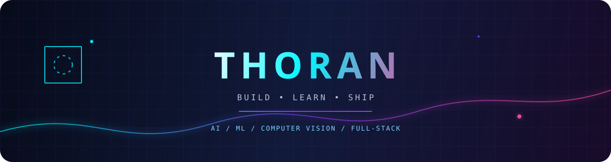

##  About me

  

I'm a developer building practical projects across **AI, machine learning, computer vision, web applications, and automation**. I enjoy learning by shipping, experimenting with new ideas, and turning technical concepts into useful products.

- 🔭 Currently building AI-powered and full-stack projects
- 🧠 Exploring machine learning, computer vision, and intelligent applications
- ⚡ I learn by building, breaking, and improving
- 🤝 Open to interesting collaborations and new ideas

## 🌐 Contact

  

  

    
    
    
  

##  Tech universe

### Languages

### Frameworks, AI & Tools

  

## 🚀 Featured projects

| Project | Description |
|---|---|
| [AthleteAI Platform](https://github.com/THORAN7/AthleteAI-Platform) | AI-powered platform for athlete-focused tools and experiences. |
| [Object Detection](https://github.com/THORAN7/Object-detection) | Computer vision project for identifying objects in images. |
| [Discord BOT](https://github.com/THORAN7/Discord-BOT) | Python bot for Discord automation and interactions. |
| [Sentiment Analysis WebApp](https://github.com/THORAN7/Sentiment-Analysis-WebApp) | Web app that analyzes sentiment from written text. |

## 📊 GitHub activity

  
  

  

## 🐍 Contribution journey

  

**Thanks for visiting — let's build something amazing! 🚀**

